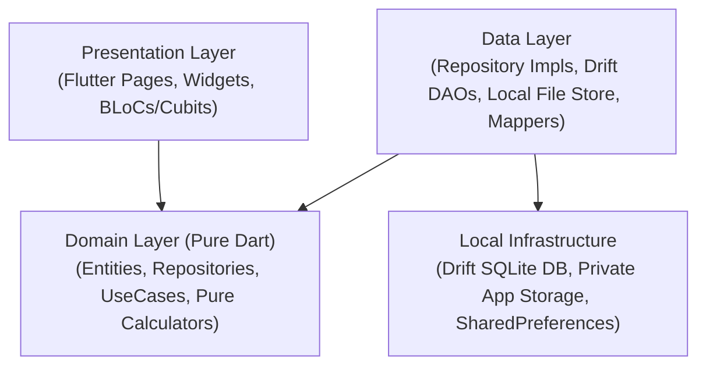
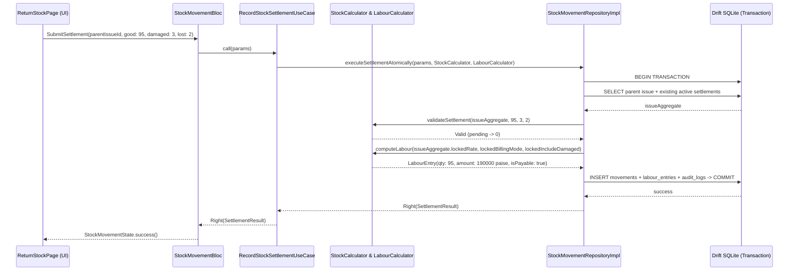

# 05 — System Architecture

## 1. Architectural Pattern: Feature-First Clean Architecture

The application follows **Feature-First Clean Architecture** with strict unidirectional dependencies:

### Layer Responsibilities

1. **Presentation Layer (`features/<name>/presentation/`):**
   - Renders UI using centralized Material 3 widgets (`lib/core/widgets/`).
   - Uses `flutter_bloc` (`Bloc` for event-driven workflows, `Cubit` for simple UI/filter state).
   - **Strictly prohibited:** Direct DB calls, Drift imports, or business math inside widgets/BLoCs.
2. **Domain Layer (`features/<name>/domain/`):**
   - **100% Pure Dart** (no `flutter`, `drift`, `flutter_bloc`, or platform imports).
   - Contains immutable `@freezed` Entities, abstract Repository interfaces, single-responsibility UseCases, Value Objects, Failure/Result types, and pure deterministic **Domain Calculators**:
     - `StockCalculator` (in-house physical stock, per-process pending, damaged bucket, over-issue/over-return guards)
     - `LabourCalculator` (Given vs. Received, Good-only vs. Damaged-inclusive, anti-double-counting)
     - `RateResolver` (`transactionAt` IST date lookup, overlap checks, rate locking)
     - `LedgerCalculator` (earned labour, regular/advance payments, advance refunds, outstanding payable vs. advance credit)
3. **Data Layer (`features/<name>/data/`):**
   - Implements Domain Repository interfaces.
   - Coordinates Drift DAOs, atomic SQLite transactions, local attachment file storage, and `audit_logs` emission.
   - Maps Drift `DataClass` / `Companion` rows to/from Domain entities.

---

## 2. Core Cross-Cutting Modules (`lib/core/`)

- **`core/config/`:** Flavor configuration (`AppFlavor`, `AppConfig`, DB name, logging toggle, media subfolder).
- **`core/database/`:** `AppDatabase` (`@DriftDatabase`), connection factory (`connection_native.dart` / `connection_web.dart`), schema migrations, and shared audit helper.
- **`core/di/`:** `get_it` + `injectable` registration (`injection.dart`, `injection.config.dart`).
- **`core/design_system/`:** Theme (`AppTheme`), color tokens, typography (with Noto Sans Gujarati), spacing, radius, sizing.
- **`core/widgets/`:** Centralized reusable Material 3 widgets (`AppScaffold`, `AppButton`, `AppCard`, `AppDataTable`, etc.).
- **`core/router/`:** `go_router` route tree, responsive shell navigation (BottomNav / NavigationRail / Sidebar).
- **`core/utils/`:** `IstDateTimeHelper` (UTC ↔ `Asia/Kolkata`), `MoneyFormatter` (paise ↔ `₹`), `IdGenerator` (UUIDv7).
- **`core/platform/`:** Platform abstractions for private file storage, photo compression, raw `.sqlite` export, and `.zip` backup/restore.

---

## 3. Data Flow Example: Recording a Partial Return

---

## 4. Future Backend Extensibility (Without V1 Bloat)

- All repositories expose `Future` / `Stream` interfaces returning Domain entities and typed `Failure` results.
- All primary keys use **UUIDv7** (`TEXT`) rather than auto-increment integers, preventing ID collisions if multi-device sync is ever added in V2+.
- All timestamps are stored in **UTC**, and all transactional tables are **append-only** with `updatedAt` and `deletedAt`, making future incremental delta-sync straightforward without rewriting `domain/` or `presentation/`.
- **Zero** networking, REST, Firebase, or Supabase code is introduced in V1.
