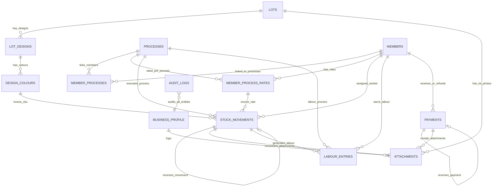

# 08 — Database Relationships & Referential Integrity

## 1. Entity Relationship Diagram

---

## 2. Cardinality & Key Relationship Rules

1. **Lot Hierarchy (`lots` → `lot_designs` → `design_colours`):**
   - `1 : N` from `lots` to `lot_designs`; `1 : N` from `lot_designs` to `design_colours`.
   - `ON DELETE RESTRICT` across the entire chain so historical inventory movements can never become orphaned.
2. **Many-to-Many Workers & Processes (`members` ↔ `member_processes` ↔ `processes`):**
   - A Member can perform multiple Processes; a Process can have multiple Members.
   - Deactivating a Member (`members.is_active = 0`), a Process (`processes.is_active = 0`), or a link (`member_processes.is_active = 0`) removes them from new assignment pickers while preserving all historical `stock_movements`, `member_process_rates`, `labour_entries`, and `payments`.
3. **Self-Referencing Stock Movements (`stock_movements.parent_issue_id`):**
   - Every `ISSUE` has `parent_issue_id = NULL`.
   - Every `RETURN_GOOD`, `RETURN_DAMAGED`, `SETTLEMENT_LOST`, and `SETTLEMENT_SHORTAGE` **must** reference a valid `ISSUE` via `parent_issue_id`.
   - Every `ADJUSTMENT_DAMAGED_TO_GOOD` operates at the `design_colour_id` level (`parent_issue_id = NULL`, `process_id = NULL`, `member_id = NULL`), keeping the schema clean and extensible for a future dedicated `repair_orders` table in V2 without migrating existing movement rows.
   - Every `REVERSAL` references the target row via `reverses_movement_id`.
4. **Labour Entries (`stock_movements` → `labour_entries`):**
   - `1 : 0..N` relationship:
     - On `ISSUE`: creates an `ISSUED` labour entry (`is_payable = 1` if `locked_billing_mode == 'GIVEN_QTY'`, else `0`).
     - On `RETURN_GOOD`: creates a `RECEIVED_GOOD` labour entry (`is_payable = 1` if `locked_billing_mode == 'RECEIVED_QTY'`, else `0`).
     - On `RETURN_DAMAGED`: creates a `RECEIVED_DAMAGED` labour entry **only if** `locked_include_damaged == 1` (`is_payable = 1` when `locked_billing_mode == 'RECEIVED_QTY'`, else `0`).
     - On `SETTLEMENT_LOST` / `SETTLEMENT_SHORTAGE`: creates **no** payable labour entry by default.
     - On `REVERSAL`: creates a compensating `REVERSAL` labour entry with negated `quantity` and `amount_paise` matching the reversed movement's `is_payable` flag.
5. **Polymorphic Attachments (`attachments`):**
   - Uses `(entity_type, entity_id)` indexed lookup so Lots, Stock Movements, Payments, and Business Profile share one unified local file management & backup pipeline.
   - Relative paths (`media/lots/<id>/<uuid>.jpg`) ensure backups restore cleanly across Android, iOS, Windows, macOS, and Linux regardless of OS root paths.

---

## 3. Referential Integrity & Soft-Delete Safeguards

- **Foreign Keys Always Enabled:** `PRAGMA foreign_keys = ON` is verified on every database open and tested in automated DB tests.
- **No Hard Deletes on Transactional Tables:** DAOs for `stock_movements`, `labour_entries`, `payments`, and `audit_logs` expose **only `INSERT` and `SELECT`** methods—no `UPDATE` or `DELETE` methods exist on those DAOs.
- **Reversal Guard on Parent Issue:** Before inserting a `REVERSAL` for an `ISSUE` row, the repository verifies inside a transaction that zero non-reversed child settlements (`parent_issue_id = issue.id`) exist.
- **Single Reversal Guard:** A movement or payment can only be reversed **once** (enforced via application transaction check + unique partial index `CREATE UNIQUE INDEX idx_sm_single_reversal ON stock_movements(reverses_movement_id) WHERE reverses_movement_id IS NOT NULL;`).
