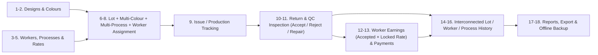

# StitchFlow — Complete User Workflow Map (18 Core Workflows)

**Audit Date:** 2026-11-24  
**Business Goal:** Ensure every end-to-end textile manufacturing workflow is simple, consistent, validated, traceable, and free of dead-ends across Mobile, Tablet, Desktop, and Web.

---

## End-to-End Manufacturing Flow

---

## Detailed Workflow Audit (Workflows 1–18)

| # | Workflow | Current Entry Points | Friction / Gaps Found | Planned Improvement |
|---|---|---|---|---|
| **1** | **Design Management** | Inline in `LotCreatePage` / `LotDetailPage` | No cross-lot search, filter, or historical design relationship view. | Add unified **Designs & Colours** view (`/designs-colours`) backed by `lot_designs` & `design_colours`, plus inline edit polish on `LotDetailPage`. |
| **2** | **Colour Management** | `VisualColourPickerSheet` during lot creation/edit | No dedicated Colour Master CRUD screen to edit/search saved colours or view historical unit prices across lots. | Colours tab in **Designs & Colours** view for full `colour_master` CRUD + historical design/lot price trail (historical prices preserved immutable). |
| **3** | **Worker Management** | Workers tab → `WorkerListPage` → `WorkerDetailPage` / `WorkerFormPage` | List uses cards only on desktop; detail page lacks empty state for zero assignments. | Paginated/sortable `AppDataTable` on desktop, 2-col worker summary, unified links to Rates, History, and Ledger. |
| **4** | **Process Management** | Settings / Dashboard / Sidebar → `ProcessListPage` → `ProcessDetailPage` | Card-only list on wide screens; multi-process routing entry could be more obvious. | Wide `AppDataTable`, persistent Sidebar link, clear multi-process routing & ordering guidance. |
| **5** | **Worker-Process Rate Assignment** | `WorkerDetailPage` → `WorkerAssignmentsPage` / `RateHistoryPage` / `RateFormPage` | Rate history lacks sortable table on desktop; historical lock explanation can be clearer. | Table view on Tablet/Desktop + plain-language note explaining effective-date snapshot locking. |
| **6** | **Lot Creation** | Lots tab → `+` → `LotCreatePage` | Long single-column form (1309 lines) on wide desktop screens; can overwhelm first-time users. | Group into clean `AppFormSection` cards with 2-col desktop inputs, required indicators, and duplicate-submit protection. |
| **7** | **Multiple Process Configuration** | `LotCreatePage` (Section 3) & `JobProcessRoutingPage` | Works cleanly with Schema v8; desktop width was cramped at `1120dp`. | Widen to `1480dp` on desktop with clearer step ordering and add-process affordances. |
| **8** | **Worker Assignment (Stock Issue)** | `StockIssuePage` / `LotCreatePage` / `JobProcessRoutingPage` | Rate lock works properly; form needs clearer responsive layout and quick jump from Lot Detail. | Standardize responsive form sections and clear locked-rate preview badge. |
| **9** | **Production Tracking** | `DashboardPage`, `StockMovementsPage`, `InventoryOverviewPage`, `ProductionHistoryDashboardPage` | Desktop sidebar vanished when navigating from Dashboard to Inventory or Production History. | Persistent `ShellRoute` sidebar + breadcrumbs + wide paginated tables. |
| **10** | **Return Management** | `ReceiveReturnPickerPage` → `StockSettlementPage` | Picker used cards even on 1440px monitors; 2-stage flow benefits from clearer visual reconciliation strip. | Paginated table picker on wide screens + explicit Assigned / Returned / Pending QC / Outstanding reconciliation bar. |
| **11** | **Quantity Acceptance & Rejection** | `StockSettlementPage` (immediate) & `InspectionQueuePage` (pending QC + rejection repairs) | Requires PIN auth cleanly on native; needs Web-safe PIN hashing and wide table view for QC queue. | Web-safe `PinHasher` + wide responsive QC queue & clear Repair/Re-Approve economics indicator. |
| **12** | **Worker Earnings** | Domain `LabourCalculator` + `WorkerLedgerPage` + `AccountingOverviewPage` | Finalized rule (`Accepted × Historical Rate`) enforced in domain; legacy unit tests still assert old `GIVEN_QTY`/`includeDamagedInLabour` behavior. | Stabilize tests in Phase 6 proving legacy settings can never alter new earnings; display plain-language formula breakdown. |
| **13** | **Worker Payments** | `AccountingOverviewPage` / `WorkerLedgerPage` → `PaymentFormPage` / `WorkerAdjustmentFormPage` | Forms clear; `AccountingOverviewPage` & `WorkerLedgerPage` lacked paginated wide tables. | Upgrade both to `AppDataTable` on Tablet/Desktop with distinct badges for Regular, Advance, Refund, and Adjustments. |
| **14** | **Lot History** | `LotDetailPage` → `LotHistoryPage` & `LotTimelinePage` | Newly built in Schema v8; needs wide table layout and event-type filters on Timeline. | Wide paginated assignments table + Timeline filter chips + tap-to-transaction detail. |
| **15** | **Worker History** | `WorkerDetailPage` & `WorkerProductionHistoryPage` | Works with Schema v8; needs wide paginated table and process filter polish. | Wide `AppDataTable` + `AppFilterBar` + direct navigation to Lot/Process/Ledger. |
| **16** | **Process History** | `ProcessDetailPage` & `ProcessHistoryPage` | Works with Schema v8; needs wide paginated table and date/worker/lot/design/colour filters. | Wide `AppDataTable` + `AppFilterBar` + direct links to Lot & Worker. |
| **17** | **Reports** | `ReportsPage` & `DailySummaryPage` | Print/PDF is Android-only MethodChannel; Excel/CSV uses `dart:io` + `Isolate.run` (breaks Web); tables lack sorting & pagination. | Add sortable/paginated `AppDataTable`, Web Blob `.xlsx`/`.csv` downloads, and browser HTML print/Save-as-PDF. |
| **18** | **Settings, Security & Backup** | `SettingsHomePage` + 10 sub-pages | Backup & Security unconditionally import `dart:io`; Settings home lacks quick link to Designs & Colours. | Platform-conditional Web + Native Backup/Security/Notifications + Designs & Colours shortcut. |
